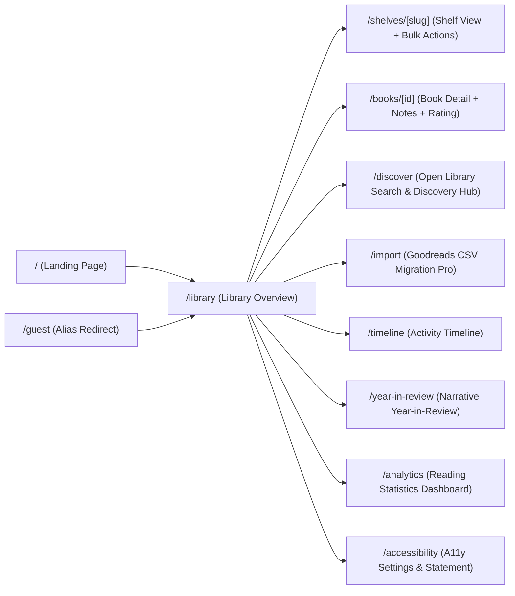
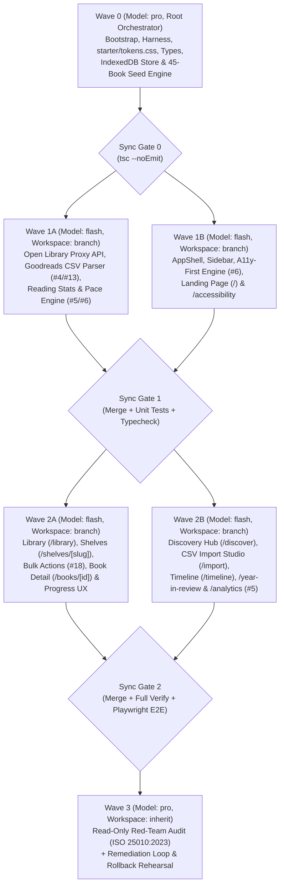

# Bookshelf (Personal Reading Tracker) — SDD Специфікація та План Реалізації

> [!IMPORTANT]
> **Статус фази:** Режим `Plan` (Read-Only). Жодного файла в цільовому каталозі `c:\Users\learn\Documents\antigravity\keen-bell` ще не створено і не змінено. Перехід до Фази 2 (Bootstrap & Multi-Agent DAG Implementation) відбудеться виключно після вашої контрольної фрази:
> **`ПЛАН ЗАТВЕРДЖЕНО. ПОЧИНАЙ IMPLEMENTATION.`**

---

## 0. Реєстр погоджень (Approval Ledger) та Вхідний Контекст

| Блок / Етап | Статус | Узгоджені ключові рішення |
|---|---|---|
| **Блок 1: Продукт і Scope** | `approved` | **Frontend-Only / Local-First** офіційна архітектура (`spec/technical-requirements.md`); усі **12 Core** + усі **7 Stretch** фіч (#13–#19); **3 Differentiators**: **#4** Goodreads Data Migration Pro, **#5** Reading Statistics Dashboard, **#6** Accessibility-First Reading Tracker; мова інтерфейсу — **English (`lang="en"`)**; цільовий стан — **`local green`** (зовнішні дії лише за окремим дозволом). |
| **Блок 2: UX, UI та Дані** | `approved` | Дві окремі сторінки аналітики в сайдбарі: **`/year-in-review`** (сторітелінг у стилі Spotify Wrapped) та **`/analytics`** (технічний дашборд Differentiator #5); оновлення прогресу через **Quick-Increment чіпи (`+10p`, `+25p`, `+50p`) + точний Popover** із логуванням у `ReadingSessionLog`; **Discovery Hub (`/discover`)** на базі Open Library API + 5 курованих добірок; незалежний `readingStatus` / `dateFinished` (щоб кастомна полиця `"Favorites"` не ламала статистику прочитаного) та безпечне перенесення книг у `"Want to Read"` при видаленні кастомної полиці. |
| **Блок 3: Архітектура і Якість** | `approved` | **Next.js (App Router, TypeScript strict)** + **Tailwind CSS v4** (`starter/tokens.css`) + **IndexedDB** (основне сховище) + **localStorage** (синхронний кеш теми й A11y без FOUC) + **кастомні доступні SVG-графіки** з табличними фолбеками + **двоетапний імпорт CSV** (миттєвий парсинг <200ms + прев'ю конфліктів + фонова черга дозбагачення Open Library 1 req/s з Pause/Cancel) + **Vitest & Playwright**. |
| **Блок 4: Виконання і Випуск** | `approved` | Multi-Agent DAG (`Wave 0` на `pro`, `Wave 1–2` на `flash` у `Workspace: 'branch'`, `Wave 3` Red-Team Audit на `pro`), детермінований гейт `npm run verify` (`exit code 0`), браузерний смоук-тест (Zero-404 / Zero-Console-Error), репетиція rollback у disposable-середовищі. |
| **Дозвіл на Implementation** | `pending` | Очікує контрольної фрази: `ПЛАН ЗАТВЕРДЖЕНО. ПОЧИНАЙ IMPLEMENTATION.` |

### Вихідний стан цільового каталогу (Read-Only Preflight Observation)
- **Цільовий каталог:** `c:\Users\learn\Documents\antigravity\keen-bell`
- **Фактичний вміст:** Порожній робочий каталог із порожнім Git-репозиторієм (гілка `master`, коміт `b9b7fda Initial commit`, `working tree clean`, жодних файлів коду чи конфігурацій).
- **Стартові матеріали:** Розпаковані у тимчасову read-only директорію `scratch/uploaded_zip/personal-reading-list` (`spec/*`, `guidance/*`, `starter/tokens.css`, `starter/tailwind.css`, `data/sample-books.json`, `data/sample-books.csv`, `preview.jpg`, `README-template.md`).

---

## 1. Product Goal & Observable Success Criteria

- **Мета продукту:** Створити персональний трекер читання **Bookshelf** («*Your reading life, beautifully organized*») з естетикою теплої незалежної книгарні (`Lora` + `Inter`), що поєднує керування полицями, пошук і відкриття книг через Open Library API, низькофрикційний трекінг прогресу, професійну міграцію з Goodreads CSV (**Differentiator #4**), глибоку візуалізацію даних (**Differentiator #5** + окремий **Year-in-Review**) та еталонну інклюзивність (**Differentiator #6 Accessibility-First**).
- **Вимірні критерії успіху (Observable Criteria):**
  1. **Zero-Friction First Impression:** При першому відкритті `/library` (або `/guest`) автоматично ініціалізується курована бібліотека з **45 реальних книг** (`data/sample-books.json`), розподілених у повній відповідності до `preview.jpg` та `data/README.md`: `Currently Reading` (5), `Want to Read` (15), `Read` (20), `Favorites` (5), із активною річною ціллю **15 / 24 книг (63%) у 2026 році** та згенерованою історією читання за 2025–2026 рр.
  2. **100% Edge-Case Resilience:** Жодна книга з неповними метаданими в `sample-books.json` чи Open Library API (відсутня обкладинка у 5 книг, відсутній `pageCount` у 2 книг, відсутній `isbn10` у 4 книг, відсутній будь-який ISBN в *Eloquent JavaScript*, відсутній опис у *The Mythical Man-Month*, співавтори у *The Pragmatic Programmer*) не спричиняє помилок рендеру чи зламаних картинок.
  3. **Goodreads CSV Pro Accuracy:** Імпорт еталонного `data/sample-books.csv` (45 рядків з `="ISBN"`, `Author l-f`, `Rating: 0`, HTML-сутностями в рецензіях та мульти-полицями) парситься за `< 200ms`, коректно виявляє дублікати й надає інтерактивне вирішення конфліктів (*Keep Existing / Replace / Skip*).
  4. **Deterministic Quality Gates:** Усі автоматизовані перевірки (`lint`, `typecheck`, `test`, `build`, Playwright E2E + Console/Network Zero-404/Zero-Error gate) завершуються з `exit code 0`, а Red-Team аудит за стандартом ISO/IEC 25010:2023 досягає оцінки **`Grade A / Ready for Prod`**.

---

## 2. Users & Core Journeys

- **Цільові профілі користувачів:**
  1. **The Avid Reader & Analyst:** Читає 20–50+ книг на рік, досліджує тренди у `/year-in-review` та `/analytics` (темп по місяцях, жанровий баланс, календарний heatmap, найшвидші/найдовші книги).
  2. **The Goal-Setter:** Встановлює річну ціль (наприклад, 24 книги на 2026 рік), відстежує статус темпу (*Ahead of pace / On track / X books behind pace*) та отримує святковий візуальний відгук при досягненні 100% книги або річної цілі.
  3. **The Shelf Curator & Goodreads Migrant:** Переносить історію читання з Goodreads CSV, організовує кастомні полиці (`Favorites`, `Book Club`), використовує масові дії (Bulk Actions) та миттєвий пошук `Cmd/Ctrl + K`.
  4. **The Accessibility-Conscious Reader:** Використовує клавіатурну навігацію стрілками, скрінрідер, режим високої контрастності WCAG AAA, налаштування кегля/інтерліньяжу або шрифт `OpenDyslexic` для комфортного читання анотацій і нотаток.

- **Ключові наскрізні сценарії (Core User Journeys):**
  - **Journey 1 — Перше знайомство та огляд бібліотеки:** Візит на `/` (Landing Page з вітриною обкладинок і перевагами) ➔ клік `"Open My Library"` (або прямий перехід на `/guest` чи `/library`) ➔ миттєвий огляд дашборду з 45 книгами, секцією `"Currently Reading"` з прогрес-барами, віджетом `"Reading Goal 2026 (15 / 24)"` та прев'ю полиць.
  - **Journey 2 — Трекінг прогресу та завершення книги:** На картці книги в `"Currently Reading"` клік по чіпу `+25p` (або відкриття точного Popover для вводу сторінки / відсотка для книг без `pageCount`) ➔ миттєве оптимістичне оновлення прогрес-бару, запис сесії у `ReadingSessionLog` та `ActivityEvent` ➔ при досягненні `100%` з'являється celebratory банер із пропозицією перемістити книгу в `"Read"` та виставити рейтинг 1–5 зірок.
  - **Journey 3 — Пошук і відкриття нових книг (Open Library + Discovery):** Перехід у `/discover` ➔ перегляд персоналізованих добірок *"Because you enjoyed Sci-Fi & Fantasy"* або курованих колекцій ➔ живий пошук через Open Library API з індикацією книг, що вже є в бібліотеці (`"In your library"`) ➔ додавання книги в 1 клік із вибором цільової полиці.
  - **Journey 4 — Імпорт Goodreads CSV та резолюція конфліктів:** Завантаження `sample-books.csv` (або власного файлу до 500+ книг) на `/import` ➔ миттєвий парсинг і таблиця прев'ю з підсвіткою знайдених дублікатів ➔ вибір стратегії (*Skip duplicates / Replace / Keep existing*) ➔ збереження в IndexedDB ➔ запуск фонової черги дозбагачення відсутніх обкладинок/описів через Open Library API (1 запит/с із можливістю Pause/Cancel).
  - **Journey 5 — Рефлексія: Year-in-Review vs Analytics Dashboard:** Перегляд сторітелінг-досвіду `/year-in-review` (картки досягнень року, топові жанри, книжкові рекорди, перемикач `2026 So Far` / `2025` / `All Time`) та перехід у `/analytics` для глибокого дослідження інтерактивних графіків і календарного heatmap.

---

## 3. Pages, Routes & UI States



| Маршрут | Призначення | Стани UI (Loading / Empty / Error / Success) |
|---|---|---|
| `/` | **Landing Page** (Core #9): літературний Hero, візуальна вітрина обкладинок і статистики, 4 картки можливостей, основний CTA `"Open My Library"` + вторинний `"Explore Year in Review"`. | Миттєвий SSR/SSG рендер без мережевих блокувань (`TTI < 2s`). |
| `/guest` | **Frontend Mentor Reporter Entry** (Core #10): безшовний редірект/аліас на `/library` із гарантованою ініціалізацією 45 демо-книг. | Прозорий перехід зі збереженням демо-бібліотеки. |
| `/library` | **Library Overview Dashboard** (Core #4, #5, #6, #14): пріоритетна секція `"Currently Reading"` (з Quick-Increment чіпами), прев'ю всіх полиць (по 5–8 книг із кнопкою `"See all"`), глобальна фільтрація (жанр, автор, рейтинг), сортування та миттєвий пошук `Cmd/Ctrl+K` або `/`. | **Loading:** 2:3 cover skeletons. **Empty Library:** теплий онбординг зі швидким імпортом CSV, завантаженням демо-бібліотеки або переходом у `/discover`. |
| `/shelves/[slug]` | **Dedicated Shelf View** (Core #2, Stretch #18): повна сітка книг обраної полиці (`all`, `currently-reading`, `want-to-read`, `read` або кастомної), керування полицею (перейменування/видалення/зміна порядку), панель **Bulk Actions** (переміщення, додавання жанру, видалення з підтвердженням). | **Empty Shelf:** *"This shelf is waiting for its first book. Search or browse discoveries to add one."* |
| `/books/[id]` | **Book Detail View** (Core #3, #5, Stretch #16): велика обкладинка (або типографічний плейсхолдер), метадані (лише наявні поля — без порожніх заглушок!), перемикач полиці, віджет прогресу читання, інтерактивний 5-зірковий рейтинг, мультижанрові теги з автодоповненням, редактор особистих нотаток (шрифт `Lora` з налаштуваннями A11y), посилання на Open Library. | **Not Found:** дружня сторінка з поверненням у `/library`. **Sparse Metadata:** адаптивна верстка без пустих рядків для книг без ISBN або опису. |
| `/discover` | **Book Search & Discovery Hub** (Core #1, #12, Design Challenge #2): пошук через Open Library API (за назвою, автором, ISBN), персоналізовані секції *"Because you enjoyed [Genre/Author]"*, 5 курованих стартових колекцій для холодного старту, бейдж `"In your library"` для вже доданих книг, вибір полиці при додаванні. | **Loading:** 2:3 картки-скелетони. **Empty Search:** підказки щодо перевірки правопису або пошуку за автором. **API Error / 429:** інформативний банер із кнопкою Retry та доступом до курованих списків. |
| `/import` | **Goodreads CSV Migration Studio** (Stretch #13, Differentiator #4): drag-and-drop завантаження `.csv` + кнопка *"Load Sample Goodreads CSV (45 books)"* для миттєвого тестування; таблиця прев'ю з резолюцією дублікатів (*Keep Existing / Replace / Skip*); дашборд результатів імпорту; фонова черга дозбагачення метаданих через Open Library API (1 req/s) із прогрес-баром та кнопкою Pause/Cancel. | **Malformed CSV:** чітке пояснення помилки парсингу із номером рядка/колонки. **Large Import (500+):** плавний прогрес без зависання UI. |
| `/timeline` | **Activity Timeline** (Stretch #17): хронологічна стрічка подій (`book_added`, `book_finished`, `progress_updated`, `rating_updated`, `goal_updated`, `csv_imported`) із фільтрацією за типом події, відносними/абсолютними датами та прямими посиланнями на книги. | **Empty Filter:** повідомлення про відсутність подій обраного типу з кнопкою скидання фільтра. |
| `/year-in-review` | **Narrative Year-in-Review** (Design Challenge #1): окремий візуально виразний сторітелінг-екран (у дусі Spotify Wrapped) із перемикачем року (`2026 So Far`, `2025`, `All Time`), святковими главами (Total Books & Pages, Top Genres, Fastest & Longest Read, Seasonal Rhythm, Highest Rated Gems) та адаптивним режимом *"Early Chapter"* для користувачів із `< 5` прочитаними книгами. | **Light Reader (<5 books) / Empty Year:** теплий підтримуючий наратив без порожніх графіків. |
| `/analytics` | **Reading Statistics Dashboard** (Differentiator #5): інтерактивний аналітичний дашборд: 1) Reading Pace Chart (книги та сторінки по місяцях), 2) Genre Distribution Donut (із клік-фільтрацією), 3) Page Count Histogram, 4) Rating Patterns (розподіл оцінок + найщедріші/найсуворіші місяці), 5) Author Diversity, 6) GitHub-style Daily Reading Calendar Heatmap, 7) Time-to-Finish Analysis + YoY порівняння. Кожен графік має доступний табличний фолбек (`<details>` / ARIA). | **Empty Data:** інформативний стан із поясненням, які дії наповнять графіки. |
| `/accessibility` | **Accessibility Center & Statement** (Differentiator #6): панель живого налаштування читабельності (тема Light / Dark / WCAG AAA High-Contrast, розмір шрифту описів і нотаток `100%–150%`, міжрядковий інтервал, перемикач шрифту `OpenDyslexic`, примусовий `Reduced Motion`), довідник клавіатурних скорочень та офіційна Accessibility Statement. | Миттєве застосування налаштувань без перезавантаження. |

---

## 4. Design Tokens & Responsive Behavior

- **Джерело дизайн-токенів:** Пряме підключення наданих файлів `starter/tokens.css` та `starter/tailwind.css` у глобальний стилізаційний конвеєр.
- **Кольорова палітра (Warm Literary Aesthetic):**
  - **Light Mode:** `--color-bg-primary: #FAF8F5` (паперовий теплий фон), `--color-bg-secondary: #F3F0EB` (сайдбар, картки), `--color-surface: #FFFFFF`, `--color-text-primary: #2C2420` (глибокий теплий коричневий), `--color-accent: #A8612B` (теплий бурштин/мідь), `--color-rating: #D4A03E`, `--color-success: #3D7C4F`.
  - **Dark Mode (`[data-theme="dark"]` + `prefers-color-scheme: dark`):** `--color-bg-primary: #1A1512`, `--color-bg-secondary: #231E1A`, `--color-text-primary: #EDE8E2`, `--color-accent: #D4964A`, `--color-rating: #E0B84A`.
  - **High-Contrast Mode (`[data-contrast="high"]` — Differentiator #6):** розширений набір токенів із контрастністю **WCAG AAA ($\ge 7:1$)** для основного тексту та посиленими межами інтерактивних елементів (`2px solid`).
- **Типографіка:**
  - Заголовки (`h1`–`h3`), описи книг та особисті нотатки: **`Lora`** (serif).
  - Інтерфейс, навігація, бейджі, таблиці, графіки: **`Inter`** (sans-serif).
  - Код / ISBN / технічні метадані: **`JetBrains Mono`** (monospace).
  - Опція доступності (Differentiator #6): перемикач **`OpenDyslexic`** (або розширений трекінг/інтерліньяж) для блоків читання описів та нотаток.
- **Адаптивна сітка та Layout (`guidance/brand-kit.md` & `guidance/patterns.md`):**
  - Десктопний сайдбар: `--sidebar-width: 15rem` (240px) зі списком полиць, лічильниками книг, швидкими посиланнями та віджетом `Reading Goal` внизу (як на `preview.jpg`), з можливістю згортання (collapsible sidebar).
  - Мобільна навігація (`< 768px`): нижня панель швидкого доступу + висувний drawer для всіх полиць; відсутність горизонтального скролу; мінімальний розмір сенсорних цілей **`44x44px`** (зірки рейтингу, чіпи `+10p/+25p`, кнопки полиць).
  - Обкладинки книг: суворе співвідношення сторін **`2:3`** (`aspect-[2/3]`), тінь `--shadow-book`, делікатний підйом на hover (`translateY(-2px)` з повагою до `prefers-reduced-motion`).

---

## 5. UI Components & Patterns

- **Навігація та App Shell:**
  - `src/components/layout/AppShell.tsx` — адаптивний каркас із Skip-to-content посиланням, сайдбаром, верхнім баром пошуку та глобальною `aria-live="polite"` зоною анонсів для скрінрідерів.
  - `src/components/layout/Sidebar.tsx` — навігація по полицях із точними бейджами кількості, кнопкою створення кастомної полиці, переord-контролами (вгору/вниз або drag-and-drop) та компактним віджетом річної цілі (`15 / 24 books · 63% complete`).
  - `src/components/layout/HeaderSearchModal.tsx` — глобальний пошук по власній бібліотеці (`/` або `Cmd/Ctrl + K`) та швидкий перехід до пошуку в Open Library.
  - `src/components/a11y/KeyboardShortcutsModal.tsx` — модальне вікно за клавішею `?` із переліком усіх клавіатурних скорочень.
- **Книжкові компоненти:**
  - `src/components/books/BookCover.tsx` — компонент обкладинки 2:3 із lazy-loading, плавним fade-in та автоматичним **Типографічним Плейсхолдером** (назва книги у `Lora` + автор у `Inter` на теплому текстурному фоні з декоративною рамкою), якщо `coverUrl === null` або зображення не завантажилося (`onError`).
  - `src/components/books/BookCard.tsx` — картка книги для сітки (обкладинка + назва + автор; без візуального шуму ISBN/видавництва у сітці) та розширена горизонтальна картка для `"Currently Reading"` (як на `preview.jpg`: обкладинка зліва, назва, автор, жанровий бейдж, прогрес-бар з відсотком та Quick-Increment чіпами `+10p`, `+25p`, `+50p`).
  - `src/components/books/ProgressPopover.tsx` — поповер точного оновлення прогресу (ввід сторінки `0..pageCount` або `0..100%` для книг без `pageCount`, опційна коротка нотатка сесії) + банер святкування 100% завершення.
  - `src/components/books/StarRatingInput.tsx` — доступний радіо-компонент оцінювання (1–5 зірок, клавіші `ArrowLeft`/`ArrowRight`, мішені `44x44px`, чіткий текстовий підпис `"4 out of 5 stars"`).
  - `src/components/books/BulkActionBar.tsx` — плаваюча панель при виборі книг чекбоксами (лічильник вибраних, переміщення на полицю, додавання жанрового тегу, видалення з модальним підтвердженням).

---

## 6. Functional Rules & Edge Cases

1. **Правило єдиної полиці та збереження історії прочитаного (`Shelf` vs `ReadingStatus`):**
   - Книга завжди належить рівно одній полиці (`shelfId`).
   - Переміщення книги на системну полицю `"Read"` автоматично виставляє `isRead: true`, `progressPercent: 100` та `dateFinished` (якщо ще не задано).
   - Переміщення вже прочитаної книги на кастомну полицю (наприклад, `"Favorites"`, як у 5 книг із `preview.jpg`) змінює її `shelfId` на `"favorites"`, але **зберігає `isRead: true` та `dateFinished`**, завдяки чому річна ціль (`15 / 24 books`) та статистика року залишаються консистентними.
   - При видаленні кастомної полиці користувачем вона не може видалити книги з бібліотеки: усі книги з цієї полиці автоматично переносяться на системну полицю `"Want to Read"` (або на `"Read"`, якщо книга має `isRead: true`), про що повідомляється у підтвердженні. Системні полиці (`Currently Reading`, `Want to Read`, `Read`) захищені від видалення.
2. **Розрахунок темпу річної цілі (`Reading Goal Pace` — Core #6):**
   - Очікувана кількість прочитаних книг на поточний день року обчислюється за формулою:
     $$\text{ExpectedBooks} = \text{TargetCount} \times \frac{\text{DayOfYear}}{\text{DaysInYear}}$$
   - Різниця $\Delta = \text{CompletedBooks} - \text{ExpectedBooks}$ визначає статус:
     - $\Delta \ge 1$: **Ahead of pace** (`+N books ahead of schedule`, іконка + текст, не лише колір);
     - $-1 < \Delta < 1$: **On track** (`Right on pace`);
     - $\Delta \le -1$: **Behind pace** (`N books behind pace — still plenty of time!`, дружній тон без провини).
3. **Обробка всіх документованих Edge Cases (`data/README.md`):**
   - **Відсутні обкладинки (`coverUrl: null` у 5 книгах):** *Piranesi*, *The Dispossessed*, *Four Thousand Weeks*, *Thinking in Bets*, *A Philosophy of Software Design* — рендерять стилізований типографічний постер із назвою та автором (`alt="Cover placeholder for [Title] by [Author]"`).
   - **Відсутній `pageCount` (`null` у 2 книгах):** *Eloquent JavaScript*, *Say Nothing* — автоматично перемикають ввід прогресу в режим відсотків (`0%–100%`), а Quick-Increment чіпи показують `+5%`, `+10%`, `+25%`.
   - **Варіації ISBN:** *Eloquent JavaScript* (`isbn10: null, isbn13: null`) дедуплікується та шукається за нормалізованим ключем `normalizeKey(title) + "::" + normalizeKey(author)`.
   - **Співавтори та довгі назви:** *The Pragmatic Programmer* (`David Thomas, Andrew Hunt`) та *The Immortal Life of Henrietta Lacks* коректно переносяться (`line-clamp-2` з `title` tooltip у компактних сітках).
   - **Goodreads CSV Quirks (`data/sample-books.csv`):**
     - Очищення обгорток `="9780743273565"` ➔ `"9780743273565"`.
     - Поєднання `Author` (або нормалізація `Author l-f`) із `Additional Authors`.
     - Інтерпретація `My Rating: 0` як `null` (не оцінено, а не 0 зірок).
     - Санітизація HTML-сутностей та тегів (`<br/>`, `&amp;`, `&quot;`) у колонках `My Review` та `Private Notes`.
     - Мапінг `Exclusive Shelf` (`read` ➔ `Read`, `currently-reading` ➔ `Currently Reading`, `to-read` ➔ `Want to Read`) та витягнення додаткових тегів/кастомних полиць із колонки `Bookshelves` (наприклад, `"favorites, read"`).

---

## 7. Data Model & Persistence

Усі моделі типізуються у `src/types/bookshelf.ts` без використання `any`:

```typescript
export type SystemShelfSlug = 'currently-reading' | 'want-to-read' | 'read';

export interface Shelf {
  id: string;
  slug: string;
  name: string;
  isDefault: boolean;
  position: number;
  createdAt: string;
}

export interface BookItem {
  id: string;
  title: string;
  author: string; // Combined primary + additional authors
  isbn13: string | null;
  isbn10: string | null;
  coverUrl: string | null;
  pageCount: number | null;
  publishedDate: string | null;
  genres: string[];
  description: string | null;
  publisher: string | null;
  openLibraryKey?: string | null;
  // User Library State
  shelfId: string;
  isRead: boolean;
  readCount: number;
  currentPage: number | null;
  progressPercent: number; // 0..100
  lastProgressUpdatedAt: string | null;
  rating: number | null; // 1..5 or null
  notes: string;
  dateAdded: string; // ISO date
  dateStarted: string | null;
  dateFinished: string | null; // ISO date
}

export interface ReadingSessionLog {
  id: string;
  bookId: string;
  date: string; // YYYY-MM-DD for calendar heatmap aggregation
  timestamp: string; // Full ISO timestamp
  previousPage: number | null;
  newPage: number | null;
  pagesDelta: number; // Estimated or exact pages read in session
  previousPercent: number;
  newPercent: number;
  note?: string;
}

export type ActivityEventType =
  | 'book_added'
  | 'book_finished'
  | 'progress_updated'
  | 'rating_updated'
  | 'shelf_moved'
  | 'goal_updated'
  | 'csv_imported';

export interface ActivityEvent {
  id: string;
  type: ActivityEventType;
  bookId?: string;
  bookTitle?: string;
  bookCoverUrl?: string | null;
  summary: string;
  metadata?: Record<string, string | number | boolean | null>;
  timestamp: string;
}

export interface ReadingGoal {
  year: number;
  targetBooks: number;
  updatedAt: string;
}

export interface AccessibilityPreferences {
  theme: 'light' | 'dark' | 'system';
  contrast: 'standard' | 'high'; // WCAG AAA mode
  readingFontSize: 'sm' | 'base' | 'lg' | 'xl';
  readingLineHeight: 'normal' | 'relaxed' | 'loose';
  dyslexiaFont: boolean;
  reducedMotion: 'system' | 'on' | 'off';
}
```

- **Архітектура локального збереження:**
  - **IndexedDB (`bookshelf_db_v1`):** зберігає об'єктні сховища `books`, `shelves`, `reading_sessions`, `activity_events`, `goals`. Забезпечує миттєві транзакції навіть для 500+ книг та сотень сесій без блокування UI-потоку.
  - **`localStorage` (`bookshelf_a11y_prefs_v1`):** синхронне дзеркало для `AccessibilityPreferences`, яке зчитується inline-скриптом у `app/layout.tsx` до першого малювання сторінки (0% FOUC при перемиканні Dark / High-Contrast / Dyslexia Font).

---

## 8. Stack & Architecture

- **Framework:** Next.js (App Router, React 19, TypeScript 5 strict mode).
- **Styling:** Tailwind CSS v4 + нативні CSS Custom Properties зі `starter/tokens.css` та `starter/tailwind.css`.
- **Icons:** `lucide-react` (відповідно до рекомендації `guidance/brand-kit.md`).
- **Storage & State:** Ізольований шар доступу до даних (`src/lib/db/indexed-db.ts`) з in-memory fallback для SSR/тестів + React Context / Custom Hooks із оптимістичними оновленнями (`useBookshelfStore`).
- **Book API Integration (`src/app/api/books/search/route.ts` & `src/app/api/books/enrich/route.ts`):**
  - Серверний проксі-маршрут до **Open Library API** (`https://openlibrary.org/search.json`) із нормалізацією полів, LRU-кешем у пам'яті на 15 хвилин, таймаутом 6 секунд, коректним `User-Agent` заголовком (вимога політики Open Library для підвищеного rate limit) та захистом від помилок 429/500.
- **Структура каталогів:**
  ```text
  keen-bell/
  ├── .agentic/                  # Harness, context-manifest, autonomy-journal, evidence
  ├── docs/adr/                  # Architecture Decision Records (Cognitive Debt prevention)
  ├── public/data/               # sample-books.json, sample-books.csv (для демо та тестів)
  ├── src/
  │   ├── app/                   # Next.js App Router маршрути та API Route Handlers
  │   ├── components/            # Декомпозовані UI-компоненти (layout, books, stats, csv, a11y)
  │   ├── lib/                   # Бізнес-логіка (db, seed, csv-parser, stats-engine, open-library)
  │   ├── styles/                # tokens.css, tailwind.css, high-contrast & a11y утиліти
  │   └── types/                 # Строгі TypeScript контракти (Wave 0)
  ├── tests/
  │   ├── unit/                  # Vitest юніт/інтеграційні тести (CSV, stats, deduplication, seed)
  │   └── e2e/                   # Playwright E2E та Browser Console/Network Zero-404 тести
  └── AGENTS.md                  # Правила репозиторію для агентів
  ```

---

## 9. Accessibility & Standards (WCAG 2.2 AA / AAA & EAA)

- **Семантика та Landmarks:** `<html lang="en">`, Skip Link (`"Skip to main content"`), `<nav aria-label="Main bookshelf navigation">`, `<main id="main-content">`, `<aside>`, сувора ієрархія заголовків `h1` ➔ `h2` ➔ `h3` без пропусків, списки книг через `<ul role="list">` / `<li>`.
- **Незалежність від кольору:**
  - Прогрес читання завжди містить текстовий відсоток і `progressbar` з `aria-valuenow`, `aria-valuemin="0"`, `aria-valuemax="100"`, `aria-label="Reading progress for [Title]: X%"`.
  - Статус річної цілі (*Ahead / On track / Behind*) передається іконкою та явною текстовою фразою.
  - Зірковий рейтинг реалізований як `role="radiogroup"` з керуванням стрілками та текстовим резюме.
- **Доступність графіків (`/analytics` та `/year-in-review`):**
  - Кожен SVG-графік має `role="img"`, описовий `aria-label` із ключовим інсайтом та розкривний блок `<details><summary>View data table</summary><table>...</table></details>` із повною таблицею значень для скрінрідерів і клавіатурних користувачів.
- **Differentiator #6 (Accessibility-First Controls):**
  - Панель швидкого доступу в хедері та на `/accessibility`: перемикання теми (`Light / Dark / System`), контрастності (`Standard AA / High-Contrast AAA`), шрифту описів (`Lora / OpenDyslexic`), розміру тексту (`sm / base / lg / xl`), міжрядкового інтервалу та примусового вимкнення анімацій (`Reduced Motion`).
  - Клавіатурні скорочення: `/` або `Cmd/Ctrl + K` (пошук по бібліотеці), `?` (довідка хоткеїв), `ArrowRight/Left/Up/Down` (навігація по картках книг у сітці).

---

## 10. Security & Protected Data

- **Санітизація зовнішніх даних (XSS Prevention):** Усі текстові поля з Open Library API (`description`) та імпортованих Goodreads CSV (`My Review`, `Private Notes`) очищаються від небезпечних HTML-тегів та скриптів (дозволений лише чистий декодований текст з розбивкою на абзаци `<p>`).
- **Валідація схем:** Серверні маршрути `/api/books/*` та клієнтський парсер CSV валідують вхідні параметри (обмеження розміру CSV до 10 МБ, ліміт рядків, перевірка форматів ISBN та дат).
- **Безпека посилань та заголовків:** Зовнішні посилання на Open Library відкриваються з `rel="noopener noreferrer"`; жодних секретів чи приватних API-ключів у клієнтському бандлі немає.

---

## 11. Performance & Web Vitals

| Метрика / Вимога зі специфікації | Цільовий поріг | Інженерний механізм забезпечення |
|---|---|---|
| **Landing Page Time to Interactive** | `< 2.0s` | Статичний SSR рендер без важких клієнтських бібліотек, системні/оптимізовані шрифти `next/font`. |
| **Initial Library Load** | `< 3.0s` (`< 500ms` локально) | Асинхронне зчитування з IndexedDB + миттєві 2:3 cover-скелетони для нульового CLS (`CLS < 0.05`). |
| **Library Search & Filter (`#14`)** | `< 500ms` (`< 50ms` фактично) | Мемоізований in-memory індекс по `title`, `author`, `notes`, `genres` із `useDeferredValue`. |
| **Open Library Search (`#1`)** | `< 1.5s` (включно з API) | Дебаунс вводу `300ms`, серверний LRU-кеш однакових запитів, запит компактних полів `fields=...`. |
| **Cover Image Loading (`#19`)** | 60fps scroll, no jank | Нативний `loading="lazy"`, `decoding="async"`, використання `-M.jpg` для сітки та `-L.jpg` для сторінки деталей. |

---

## 12. Test Strategy & Verification Matrix (`applicable` / `not applicable`)

### Матриця гейтів верифікації

| Gate ID | Категорія перевірки | Статус застосовності | Спосіб перевірки / Команда | Очікуваний результат та Evidence |
|---|---|---|---|---|
| **G-01** | **Baseline Existing Tests (Preflight)** | `not applicable` | Read-only перевірка порожнього каталогу `keen-bell` | Каталог порожній (greenfield); базові тести до bootstrap відсутні. |
| **G-02** | **Static Analysis & Linting** | `applicable` (to be implemented) | `npm run lint` (ESLint flat config) | `exit code 0`, 0 errors, 0 warnings. |
| **G-03** | **Strict Type Checking** | `applicable` (to be implemented) | `npm run typecheck` (`tsc --noEmit`) | `exit code 0`, суворий режим без `any`. |
| **G-04** | **Unit & Integration Tests** | `applicable` (to be implemented) | `npm run test` (`vitest run`) | `exit code 0`. Покриття: парсер `sample-books.csv` (усі 45 рядків та 10 edge cases з `data/README.md`), дедуплікація книг, розрахунок темпу цілі (`Ahead/On track/Behind`), агрегатор статистики та heatmap, seed-розподіл 45 книг. |
| **G-05** | **Production Build** | `applicable` (to be implemented) | `npm run build` (`next build`) | `exit code 0`, успішна генерація всіх маршрутів. |
| **G-06** | **E2E, A11y & Browser Console/Network Gate** | `applicable` (to be implemented) | `npm run test:e2e` (Playwright) | `exit code 0`. Перевірка всіх маршрутів (`/`, `/guest`, `/library`, `/shelves/*`, `/books/*`, `/discover`, `/import`, `/timeline`, `/year-in-review`, `/analytics`, `/accessibility`), **0 Console Errors**, **0 Network 404s** (включно з `/favicon.svg`), перевірка клавіатурної навігації та A11y-перемикачів. |
| **G-07** | **Unified Deterministic Verify** | `applicable` (to be implemented) | `npm run verify` | Послідовний запуск `typecheck && lint && test && build` з `exit code 0`. |
| **G-08** | **Red-Team & ISO 25010:2023 Audit** | `applicable` (Wave 3) | Незалежний субагент `Model: 'pro'` | Звіт `.agentic/evidence/red-team-report.md` з оцінкою `Grade A / Ready for Prod` та 0 відкритих P0/P1 дефектів. |
| **G-09** | **Disposable Rollback Rehearsal** | `applicable` (Фаза 4) | Скрипт репетиції у тимчасовій копії | Підтвердження чистого відновлення базового стану без пошкодження робочого дерева. |
| **G-10** | **Remote CI / Preview / Production Deploy** | `pending authorization` | Зовнішні дії (GitHub / Vercel) | Виконуються лише у разі окремого явного дозволу користувача на Фазі 5–6. |

---

## 13. CI, Preview & Rollback Plan

- **Локальна CI конфігурація:** У межах імплементації створюється `.github/workflows/ci.yml`, який виконує `npm ci`, `npm run verify` та Playwright smoke-тести при push/PR.
- **План відкату (Rollback Procedure):**
  1. **Відкат коду (Code Rollback):** Оскільки початковий стан репозиторію зафіксовано на коміті `b9b7fda` (`Initial commit`), повне повернення до вихідного стану виконується у disposable-репетиції (або за командою користувача) через очищення untracked файлів та скидання до `b9b7fda`.
  2. **Відкат клієнтських даних (Storage Rollback & Recovery):** В інтерфейсі додатку (у сайдбарі та на `/accessibility` / `/import`) передбачена кнопка **"Reset to Curated Demo Library (45 Books)"**, яка в одну транзакцію очищує пошкоджені або тестові дані IndexedDB і відновлює еталонний стан із `sample-books.json`.
- **Межі дозволів (Approval Boundaries):**
  - Фраза `ПЛАН ЗАТВЕРДЖЕНО. ПОЧИНАЙ IMPLEMENTATION.` дозволяє виключно **локальні дії** в `c:\Users\learn\Documents\antigravity\keen-bell`: розгортання harness, копіювання стартових даних/токенів, встановлення npm-пакетів, написання коду, запуск локальних серверів і тестів.
  - **Заборонено без окремого дозволу:** створення git commits, підключення remote repository, `git push`, відкриття PR, запуск зовнішнього деплою.

---

## 14. Observability & Autonomy

- **Артефакти прозорості та телеметрії проєкту:**
  - `.agentic/context-manifest.json` — фіксація середовища, версій Node/npm, вихідного стану Git та конфігурації гейтів.
  - `.agentic/autonomy-journal.md` — хронологічний журнал усіх архітектурних рішень, результатів синхронізації хвиль DAG та використаних моделей (`pro` / `flash`).
  - `docs/adr/001-local-first-indexeddb-architecture.md`, `docs/adr/002-decoupled-reading-status-and-shelves.md`, `docs/adr/003-two-stage-csv-migration-and-a11y.md` — документація первинних інженерних намірів для запобігання Cognitive & Intent Debt.
  - `.agentic/evidence/red-team-report.md` — повний звіт незалежного аудитора за 6 векторами 2026 року.

---

## 15. Out-of-Scope, Risks, Budgets & Multi-Agent DAG Matrix

### Out-of-Scope (Свідомо виключено для фокусу якості)
- Зовнішня хмарна БД та екрани реєстрації/паролів (обрано офіційний **Frontend-Only / Local-First** шлях зі `spec/technical-requirements.md`).
- Платні LLM-інтеграції (#2 AI Companion) та генерація растрових соцмережевих карток (#3 Social Cards) — замість них реалізуються три обрані потужні диференціатори **#4, #5, #6**.

### Ризики та запобіжники
1. **Нестабільність або таймаути Open Library API під час пошуку/тестів:** Серверний проксі `/api/books/search` має 6-секундний таймаут, кешування та graceful fallback на пошук серед локального каталогу й курованих колекцій, щоб мережеві збої стороннього сервісу ніколи не ламали UX чи E2E-тести.
2. **Контрастність теплої палітри (`guidance/accessibility.md` line 137):** Перевірка контрастності всіх текстових токенів (`--color-text-tertiary` використовується лише з достатнім розміром/вагою або підсилюється для відповідності WCAG AA $\ge 4.5:1$, а режим High-Contrast забезпечує WCAG AAA $\ge 7:1$).

### Ліміти виконання (Budgets & Circuit Breaker)
- **Максимум ретраїв воркера на одній хвилі (Circuit Breaker):** `2` спроби виправлення при падінні Quality Gate.
- **Максимальна паралельність воркерів:** `2` ізольовані гілки одночасно на хвилю.
- **Орієнтовний бюджет часу на повний локальний цикл (Фази 2–4):** ~15–25 хвилин.

### Multi-Agent DAG & File Ownership Matrix



| Хвиля | Роль / Виконавець | Модель (`pro`/`flash`) | Workspace Mode | Ексклюзивна зона володіння файлами (File Ownership Matrix) | Критерій завершення хвилі |
|---|---|---|---|---|---|
| **Wave 0** | **Root Orchestrator** (Contracts, Harness & Seed Foundation) | `pro` | `inherit` | `package.json`, `tsconfig.json`, `AGENTS.md`, `.agentic/**`, `docs/adr/**`, `public/data/**`, `src/styles/**`, `src/types/**`, `src/lib/db/**`, `src/lib/seed/**` | Базова збірка типів `npm run typecheck` (`exit code 0`), готовність контрактів і 45-book seed. |
| **Wave 1A** | **Domain & Data Services Worker** | `flash` | `branch` | `src/lib/csv/**`, `src/lib/stats/**`, `src/lib/open-library/**`, `src/app/api/books/**`, `tests/unit/**` | Усі юніт-тести парсера CSV (45 книг + edge cases), статистики та API-нормалізатора проходять (`vitest run` ➔ `0`). |
| **Wave 1B** | **App Shell, A11y Engine & Landing Worker** | `flash` | `branch` | `src/context/**`, `src/components/layout/**`, `src/components/a11y/**`, `src/app/layout.tsx`, `src/app/page.tsx`, `src/app/guest/**`, `src/app/accessibility/**` | Рендер `/`, `/guest`, `/accessibility`, робота перемикачів теми/AAA/шрифтів та `Cmd/Ctrl+K` без помилок типізації. |
| **Wave 2A** | **Library, Shelves & Book Experience Worker** | `flash` | `branch` | `src/components/books/**`, `src/components/shelves/**`, `src/app/library/**`, `src/app/shelves/**`, `src/app/books/**` | Повна робота бібліотеки, кастомних полиць, Bulk Actions, Quick-Increment прогресу (`+10p/+25p/+50p`), рейтингу та нотаток. |
| **Wave 2B** | **Discovery, Migration & Analytics Worker** | `flash` | `branch` | `src/components/discover/**`, `src/components/import/**`, `src/components/stats/**`, `src/app/discover/**`, `src/app/import/**`, `src/app/timeline/**`, `src/app/year-in-review/**`, `src/app/analytics/**`, `tests/e2e/**`, `README.md` | Повна робота `/discover`, `/import`, `/timeline`, `/year-in-review`, `/analytics` та набору E2E/Smoke тестів. |
| **Wave 3** | **Red-Team Adversarial Reviewer & Tech Debt Auditor** | `pro` | `inherit` (Read-Only) | `.agentic/evidence/red-team-report.md` (аудит `src/**`, `tests/**`, `docs/adr/**`) | Оцінка `Grade A / Ready for Prod`, `npm run verify` ➔ `0`, 0 Console/Network 404 помилок. |
